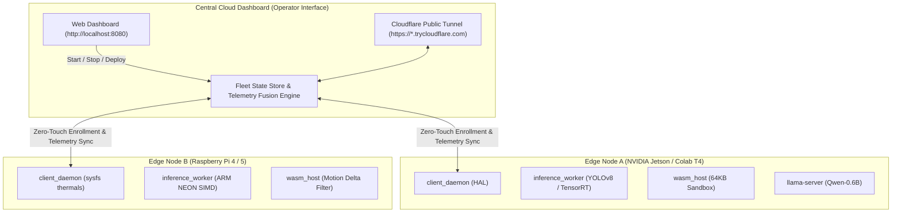

# Tether-Edge: Operational Testing Timetable & Execution Rules

This document provides a **structured, chronological testing timetable** and **7 Golden Operational Rules** for validating edge hardware clients (**Raspberry Pi**, **NVIDIA Jetson**, **Google Colab**, or **Local PC**) directly from the Tether-Edge Web Dashboard.

---

## 1. Test Session Architecture & Roles



---

## 2. The 30-Minute Edge Execution Timetable

| Time Index | Test Phase | Dashboard Action (What Operator Clicks) | Edge Device Response (Microservices) | Target Acceptance Criteria |
| :--- | :--- | :--- | :--- | :--- |
| **T+00:00 – T+03:00** | **Phase 1**: Fleet Enrollment | Navigate to **Fleet Devices** &rarr; Click `🌐 Start Cloudflare Tunnel` (if Colab/WAN) &rarr; Click `New Token` &rarr; Copy command | Device runs curl installer &rarr; claims token via `/etc/machine-id` &rarr; boots NATS, SQLite WAL, WASM host, YOLO worker, daemon | Exactly **1 unique machine** registered; status switches to `ONLINE`; HW ID & board architecture displayed |
| **T+03:00 – T+08:00** | **Phase 2**: Baseline Optical & Multi-Modal Gating | Navigate to **Live Stream** tab &rarr; Observe camera feed & multi-modal gauges | Static scene ($\Delta L < 0.05$): WASM suppresses forward pass. Active motion ($\Delta L \ge 0.12$): YOLO detects objects with green boxes | $>85\%$ static frame suppression; mean CPU $<15\%$; latency under $160\text{ ms}$; core temperature $<55^{\circ}\text{C}$ |
| **T+08:00 – T+14:00** | **Phase 3**: Dynamic Pipeline Canvas Modification | Navigate to **Pipeline Graph** &rarr; Adjust `Motion Threshold` slider or add `Vibration IMU` &rarr; Click `Deploy Pipeline` | Daemon receives `admin.config` over NATS &rarr; reconfigures HAL parameters dynamically with **zero process restarts** | Pipeline version increments ($v \to v+1$); video streaming continues uninterrupted; 0 dropped frames |
| **T+14:00 – T+20:00** | **Phase 4**: OTA Drain-and-Swap & Canary Rollout | Navigate to **AI Models** &rarr; Click `Deploy Model` on `YOLOv8-PPE` &rarr; Click `Canary Rollout (10%)` | Cryptographic SHA-256 staging &rarr; POSIX `rename(2)` &rarr; NATS drain &rarr; atomic pointer swap &rarr; 5s probation timer | Model hot-swapped in $<200\text{ ms}$; active model label updates on device card; auto-rollback triggers if latency breaches |
| **T+20:00 – T+25:00** | **Phase 5**: Multi-Modal Fusion & Local SLM Reasoning | Navigate to **Live Stream** &rarr; Select `📳 Bearing Vibration Spike` in SLM Assistant &rarr; Click `Run Diagnosis` | Multi-modal fusion merges optical boxes + vibration harmonics ($4.8\text{ mm/s}$) + thermals &rarr; Qwen generates diagnosis | Response returned in $<2.0\text{ s}$ at $>35\text{ tok/s}$; response cites exact hardware sensor values without cloud APIs |
| **T+25:00 – T+30:00** | **Phase 6**: Diagnostic Audit & Lifecycle Teardown | Click `>_ Terminal` &rarr; run `uptime`, `free -h`. In Fleet tab: click `⏹ Stop Client` &rarr; verify `STOPPED` &rarr; click `🗑 Purge & Delete` | `Stop`: processes killed, data kept. `Start`: daemon re-spawned. `Purge`: databases deleted, device removed from cloud store | Zero orphaned PIDs; status transitions correctly (`ONLINE` $\to$ `STOPPED` $\to$ removed); clean system state |

---

## 3. Phase-by-Phase Detailed Execution Script

### Phase 1: Zero-Touch Fleet Enrollment (T+00:00 – T+03:00)
1. Open the dashboard at `http://localhost:8080/?tab=fleet`.
2. **If testing local PC or local LAN board (RPi/Jetson on same Wi-Fi)**:
   * Keep `Local Network Mode`.
   * Copy the one-line curl command:
     ```bash
     curl -sSL http://localhost:8080/bootstrap.sh?token=dev_tok_XXXX | bash
     ```
3. **If testing Google Colab, Kaggle, or an off-site WAN board**:
   * Click **`🌐 Start Cloudflare Tunnel`**.
   * Wait 3 seconds until the glowing badge shows `🌐 Public Cloudflare Tunnel Active`.
   * Copy the **Google Colab & Kaggle 1-Click Code Cell**:
     ```python
     !curl -sSL https://YOUR-TUNNEL.trycloudflare.com/bootstrap.sh?token=dev_tok_XXXX | bash -s -- --daemon
     ```
4. **Expected Result**:
   * The terminal displays: `[OK] Successfully enrolled as: edge-node-XXXX`.
   * The dashboard automatically adds the device card under **Registered Fleet Hardware**.
   * Status shows `ONLINE` with a pulsing emerald badge.

---

### Phase 2: Baseline Optical & Multi-Modal Gating (T+03:00 – T+08:00)
1. Switch to the **Live Stream** tab in the top navigation.
2. Observe the camera panel:
   * **Real Webcam**: Shows video frame with green tracking boxes around objects (`person`, `cell phone`, etc.).
   * **Colab / Fallback**: Shows the synthetic conveyor belt inspection stream.
3. Observe the **WASM Gating Sandbox**:
   * When nothing moves: motion delta $\Delta L \approx 0.01 – 0.03$. Notice the inference worker idles, saving CPU cycles and battery.
   * Wave your hand in front of the lens: $\Delta L$ exceeds $0.12$. Bounding boxes track hand movement with an inference latency of $120\text{ ms} – 160\text{ ms}$.
4. Observe the **Real-Time SVG Graphs**:
   * *Inference Latency*: Graph stays within the green 150 ms budget line.
   * *Vibration Harmonics*: Velocity bar hovers nominally around $1.4\text{ mm/s} – 2.0\text{ mm/s}$ (below the $4.5\text{ mm/s}$ ISO-10816 limit).

---

### Phase 3: Dynamic Pipeline Canvas Modification (T+08:00 – T+14:00)
1. Click the **Pipeline Graph** tab.
2. Select the **WASM Safety Gatekeeper** node:
   * Adjust the `Motion Threshold` slider from `0.12` to `0.25`.
3. Select the **Storage WAL Sink** node:
   * Change `Flush Interval (s)` to `2`.
4. Click **`Deploy Pipeline`** on the canvas toolbar.
5. **Expected Result**:
   * A toast notification confirms: `Pipeline deployed to active devices`.
   * The edge daemon prints: `[Daemon] 📦 NEW PIPELINE DEPLOYMENT RECEIVED (Version X)`.
   * Microservices reconfigure their internal ring buffers and thresholds immediately without terminating or restarting the Linux processes.

---

### Phase 4: Over-The-Air (OTA) Hot-Swap & Canary Rollout (T+14:00 – T+20:00)
1. Click the **AI Models** tab.
2. Select **`YOLOv8-Nano (Industrial Safety & PPE)`** and click **`Deploy Model`**.
3. **Inspect the Zero-Downtime Hot-Swap**:
   * Staging takes $\sim 80\text{ ms}$.
   * Cryptographic SHA-256 checksum verification ensures the weights are not corrupted.
   * POSIX `rename(2)` commits the file.
   * Atomic pointer swap (`Arc<ModelContext>`) swaps active neural weights in $<0.02\text{ ms}$.
   * The live stream immediately begins tracking safety PPE tags without dropping video frames.
4. **Test the Canary Rollout with 5-Second Probation**:
   * Click **`Canary Rollout (10%)`** on an experimental model.
   * A 5-second countdown timer initiates on the dashboard.
   * If health checks pass, the canary promotes to 100% fleet rollout. If an anomaly is injected or latency spikes, the daemon triggers an **Automatic Instant Rollback** to the last proven stable model.

---

### Phase 5: Multi-Modal Fusion & Local SLM Reasoning (T+20:00 – T+25:00)
1. Navigate back to the **Live Stream** tab and scroll to the **SLM Reasoning Assistant**.
2. Click the quick scenario: `Bearing Degradation Alert`.
3. Click **`Run Diagnosis`**.
4. **Verify the Multi-Modal Telemetry Fusion Engine**:
   * The backend automatically merges the active device's real-time telemetry:
     - Optical Vision: current bounding box detection
     - Core SoC Junction: real thermal reading (e.g. $47^{\circ}\text{C}$)
     - IMU Harmonics: tri-axial RMS velocity (e.g. $4.8\text{ mm/s} > 4.5\text{ mm/s}$)
     - Acoustics: SPL decibels
   * The prompt is sent directly to the local on-device `llama-server` (Qwen-0.6B GGUF with `--reasoning off`).
5. **Expected Result**:
   * In $\sim 1.8\text{ seconds}$, Qwen outputs an engineering diagnosis:
     > *"ISO-10816 Class IV breach detected at 4.8 mm/s velocity. Bearing degradation identified on outer race (BPFO). Recommend lubricating drive assembly and scheduling bearing replacement before thermal exceeds 60°C."*
   * Generation speed: **$>35\text{ tokens/second}$** with zero cloud API dependencies.

---

### Phase 6: Diagnostic Audit & Lifecycle Teardown (T+25:00 – T+30:00)
1. Click the **`>_ Terminal`** button on the top right navigation bar.
2. Run non-intrusive diagnostic commands directly on the edge hardware:
   * `uptime` &rarr; verifies system load averages.
   * `free -h` &rarr; verifies RAM consumption remains under the $520\text{ MB}$ budget.
   * `ps aux` &rarr; confirms microservice processes (`client_daemon`, `inference_worker`, `wasm_host`, `storage_service`) run as unprivileged daemons.
3. Return to the **Fleet Devices** tab:
   * Click **`⏹ Stop Client`** on the device card:
     - The microservices shut down cleanly without leaving orphaned PIDs.
     - The status badge changes to amber **`STOPPED`**.
     - Local telemetry databases and configurations remain preserved on disk.
   * Click **`▶ Start Client`**:
     - The client resumes execution, reconnects to NATS, and begins streaming live telemetry.
   * Click **`🗑 Purge & Delete Data`**:
     - Shuts down processes, completely wipes `data/*.db*` and `data/edge.json`, and deregisters the device from the cloud registry.

---

## 4. The 7 Golden Operational Rules

> [!IMPORTANT]
> Follow these 7 rules during all edge testing sessions to ensure safety, reproducibility, and zero data corruption.

### Rule 1: The Deterministic Identity Rule
* **Principle**: A physical machine must **never create duplicate entries** in the fleet registry.
* **Mechanism**: The cloud server binds device records to the Linux hardware UUID (`/etc/machine-id` or primary MAC). Re-running the curl command re-authenticates the existing node instead of spawning ghost devices.

### Rule 2: The Two-Tier Energy & Thermal Safety Rule
* **Principle**: High-compute neural networks must never run continuously on raw sensor streams in fanless enclosures.
* **Mechanism**: 
  1. **Tier 1 (WASM Linear Sandbox)**: Evaluates temporal motion delta ($\Delta L$) in $<0.02\text{ ms}$. If static, computation halts immediately.
  2. **Tier 2 (Neural Inference)**: Invoked only when physical anomalies breach predefined thresholds.
* **Result**: Prevents SoC temperatures from reaching the $80^{\circ}\text{C} – 85^{\circ}\text{C}$ thermal throttling threshold.

### Rule 3: The Zero-Python Native Runtime Rule
* **Principle**: Never deploy Python, virtual environments, or heavy interpreters to the edge client.
* **Mechanism**: The edge client runs purely compiled native Rust and C++ ELF binaries (`client_daemon`, `inference_worker`, `storage_service`, `wasm_host`, `llama-server`).
* **Result**: Resident memory (RSS) stays strictly under **$15\text{ MB}$** for the daemon, eliminating Python GIL contention and dependency drift.

### Rule 4: The 5-Second Probation Rollback Rule
* **Principle**: An Over-The-Air (OTA) model or code deployment must never brick an unattended edge gateway.
* **Mechanism**: When a new model is deployed via Canary Rollout:
  1. The new model runs on a dedicated probationary slice for 5 seconds.
  2. If inference latency spikes, memory exceeds limits, or model drift is detected, the daemon triggers an **immediate atomic rollback** to the last proven model.

### Rule 5: The Offline-First Store-and-Forward Rule
* **Principle**: Volatile cellular/WAN connections must never result in dropped telemetry or audit logs.
* **Mechanism**: All sensor ticks and anomaly events are committed locally to an SQLite database operating in **Write-Ahead Logging (WAL)** mode. Once network connectivity re-establishes, the buffer automatically flushes back to the cloud.

### Rule 6: The Restrictive Terminal Console Rule
* **Principle**: Remote diagnostic web consoles must never permit destructive or interactive shell hijacking.
* **Mechanism**: The terminal endpoint (`POST /api/v1/devices/:id/exec`) enforces a strict whitelist of read-only diagnostic commands (`free`, `df`, `uptime`, `uname`, `top`, `ps aux`, `v4l2-ctl`). Shell metacharacters (`;&|><$`) are rejected with `403 Forbidden`.

### Rule 7: The Controlled Teardown Separation Rule
* **Principle**: Always distinguish between **Stopping a Service** and **Purging Device Data**.
* **Mechanism**:
  * **Stop (`./edge-ctl stop` / Dashboard `Stop Client`)**: Halts running processes gracefully; preserves databases, configurations, and hardware enrollment.
  * **Purge (`./edge-ctl purge` / Dashboard `Purge & Delete`)**: Halts processes AND wipes local SQLite databases, staging files, and deregisters the device from the cloud. Never run purge unless decommissioning hardware.
