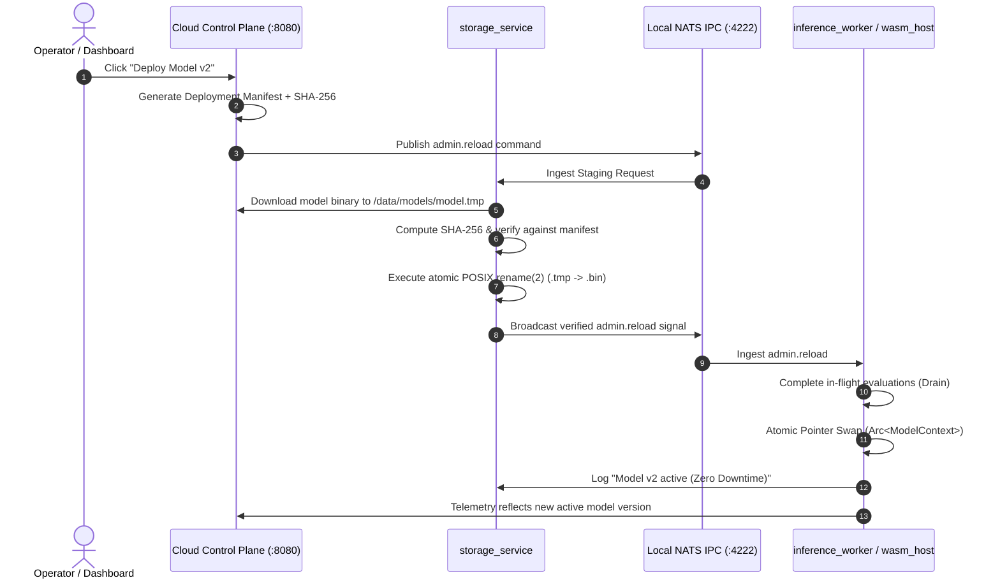

# Over-The-Air (OTA) Deployments & Hot-Reloading

This document outlines the zero-downtime model and rule deployment architecture, cryptographic verification procedures, and the one-command curl client bootstrapping mechanism.

---

## 1. Zero-Downtime Drain-and-Swap Workflow

Updating AI models or logic on the edge must not cause operational interruptions or dropped camera frames. The platform uses a **Drain-and-Swap** deployment model:



---

## 2. Cryptographic Verification & Atomic Rename

To prevent corrupted downloads (e.g. cellular network drops or power cuts during flash write), the edge storage service enforces a 2-stage commit:

1. **Staged Download**:
   Files are written strictly to a temporary staging path:
   `/data/models/{model_id}.tmp`

2. **SHA-256 Hash Verification**:
   Before replacing the running model, the entire file is hashed:
   ```rust
   let mut hasher = Sha256::new();
   let mut file = File::open(&tmp_path)?;
   io::copy(&mut file, &mut hasher)?;
   let calculated_hash = format!("{:x}", hasher.finalize());
   
   if calculated_hash != expected_sha256 {
       fs::remove_file(&tmp_path)?;
       return Err("Cryptographic verification failed: hash mismatch".into());
   }
   ```

3. **Atomic POSIX Rename**:
   The file is committed using Linux POSIX `rename(2)`:
   ```rust
   fs::rename(&tmp_path, &final_bin_path)?;
   ```
   Under Linux filesystem semantics (ext4, XFS, Btrfs), `rename(2)` is an atomic metadata operation. The active model binary is either completely replaced or remains untouched; it can never be partially corrupted.

---

## 3. Zero-Touch Curl Client Bootstrapping

When provisioning a new edge device, the operator runs a single command:
```bash
curl -sSL http://<cloud-ip>:8080/bootstrap.sh?token=<claim-token> | bash
```

### What Happens Under the Hood:
1. **Token Validation**: The cloud validates the single-use provisioning token.
2. **Bundle Download**: Downloads `edge-client-bundle.tar.gz` (compiled binaries for `client_daemon`, `inference_worker`, `wasm_host`, `storage_service`, and `wasm_worker.wasm`).
3. **Environment Setup**: Unpacks binaries into `/opt/edge-platform/` or local working directory, registers device ID, and stores `data/edge.json`.
4. **Daemon Launch**: Boots local NATS broker and launches client microservices in release mode.
5. **Initial Sync**: Connects back to `http://<cloud-ip>:8080/api/v1/devices`, reporting online status and hardware peripherals.
